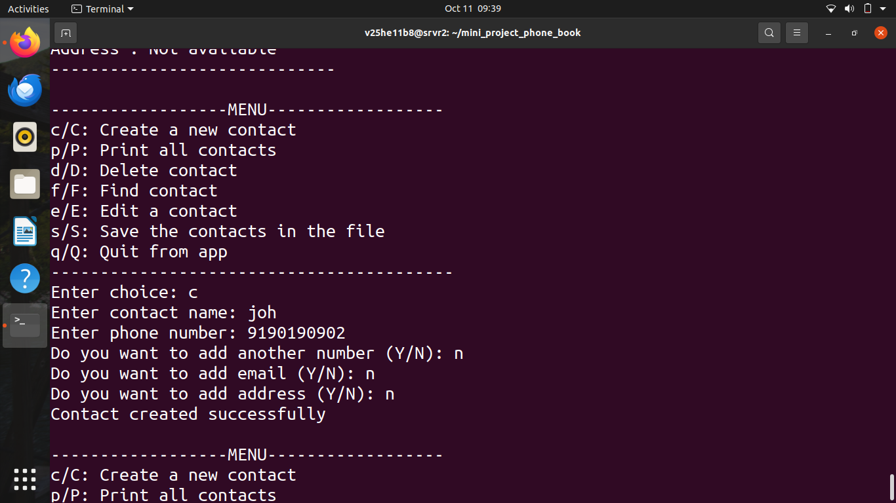
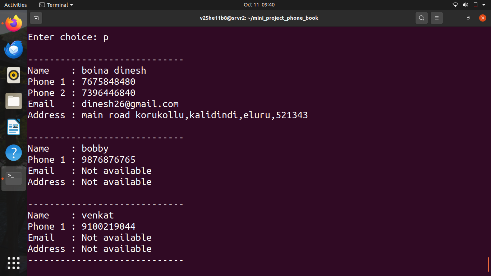
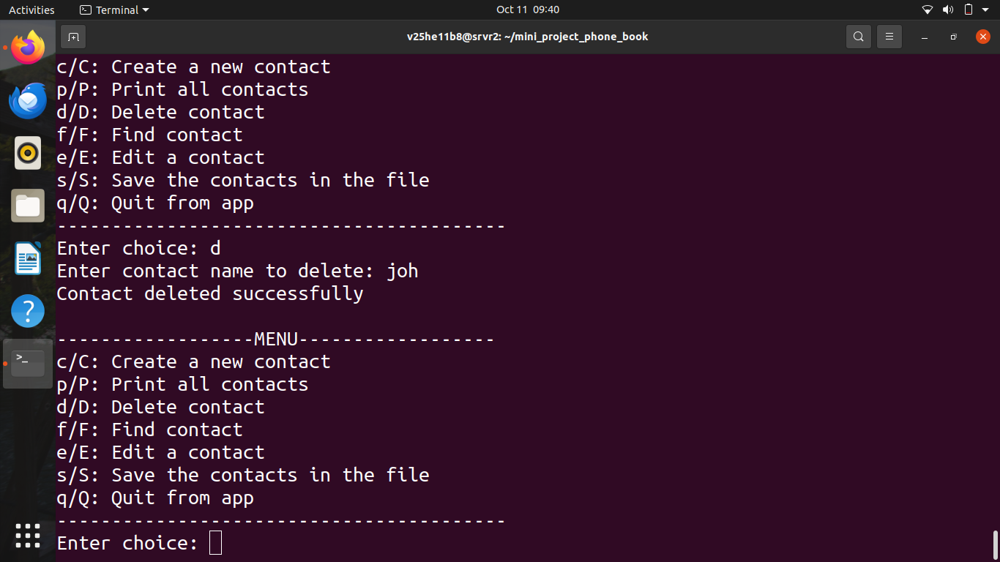
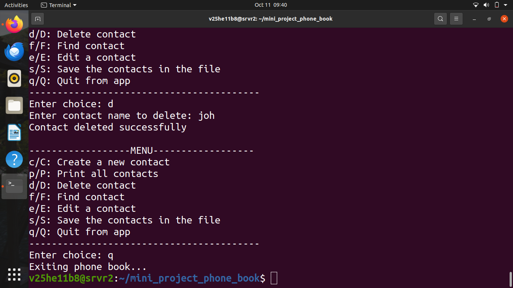

PHONE BOOK APPLICATION
======================

PROJECT:
Phone Book Application using Singly Linked List.

FEATURES:
1. Create contact
2. Print all contacts
3. Find contact
4. Delete contact
5. Edit contact
6. Add multiple phone numbers
7. Add email
8. Add address
9. Save contacts to file
10. Load old contacts when application starts

DATA STRUCTURE:
Singly Linked List

FILES:
main.c       - Main menu
contact.h    - Structure, enum and function declarations
input.c      - Input functions
create.c     - Create contact
print.c      - Print contacts
find.c       - Find contact
delete.c     - Delete contact
edit.c       - Edit contact
save.c       - Save contacts
load.c       - Load contacts
free.c       - Free linked list memory
makefile     - Compile project

COMPILATION:
make

EXECUTION:
./phonebook

CLEAN:
make clean

MENU:
c/C - Create a new contact
p/P - Print all contacts
d/D - Delete contact
f/F - Find contact
e/E - Edit a contact
s/S - Save contacts
q/Q - Quit

FILE:
Contacts are stored in phonebook.dat.

IMPORTANT:
After creating or editing contacts, select S/s to save.
When the application is launched again, saved contacts are loaded automatically.

## Screenshots

### Create Contact

### Display Contacts

### Delete Contact

### Exit Application

